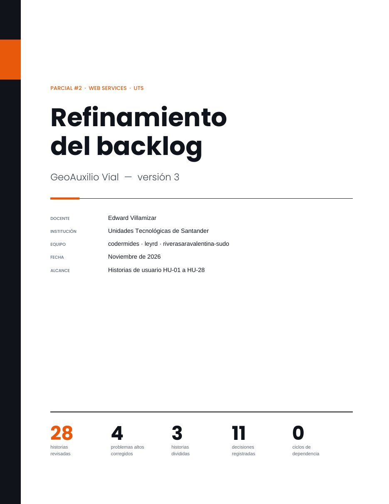

# GeoAuxilioVial
GeoAuxilio Vial brinda asistencia vial inmediata (ponchaduras, batería, grúa) y resuelve la falta de seguimiento preventivo. Cotiza solicitudes, asigna al proveedor más cercano, rastrea rutas en tiempo real y programa mantenimientos. Gestiona usuarios, vehículos, ubicaciones, historial, pagos y calificaciones con geolocalización y pagos seguros.

## Refinamiento del backlog

[](docs/refinamiento/Refinamiento_Backlog_GeoAuxilioVial_final.pdf)

📄 **[Abrir el PDF del refinamiento del backlog](docs/refinamiento/Refinamiento_Backlog_GeoAuxilioVial_final.pdf)**

- 28 historias de usuario revisadas (HU-01 a HU-28).
- 4 problemas de prioridad alta corregidos (HU-28, HU-12/HU-19, HU-26 y HU-25).
- 3 historias de talla XL divididas en sub-issues (HU-19, HU-20 y HU-26).
- 11 decisiones abiertas registradas con propuesta, responsable e impacto.
- Grafo de dependencias sin ciclos, ordenado en 9 olas de trabajo.

## Historias de usuario

Las 28 historias están en [`docs/historias_usuario`](docs/historias_usuario/README.md).

## Migración aditiva de proveedores (HU-17)

Antes de ejecutar una versión que use los campos operativos de proveedor, ejecute desde la raíz del proyecto:

```powershell
.\venv\Scripts\python.exe migrate_hu17_provider_columns.py
```

El script usa la conexión configurada en `DATABASE_URL`, comprueba las columnas existentes mediante SQLAlchemy y agrega únicamente las columnas HU-17 que falten en `proveedores`. Es idempotente, no elimina ni recrea datos y no usa Alembic. Las tablas nuevas del microservicio se crean mediante el mecanismo existente de SQLAlchemy.

La tabla `proveedores` se define en `app/domain/proveedor_domain.py` y se crea por el `Base.metadata.create_all()` existente al inicializar el catálogo. HU-14 guarda los datos comerciales, coberturas, documentos y registros privados en tablas propias del microservicio. `archivos_privados` referencia al proveedor mediante FK; no hay endpoint público de carga ni se devuelve la clave de almacenamiento.

Decisión de diseño: usuarios y proveedores son servicios independientes, por eso no hay FK física entre ellos. usuario_id se toma del JWT y se valida en la aplicación antes de registrar. La FK de archivoId a proveedor es interna del servicio.
