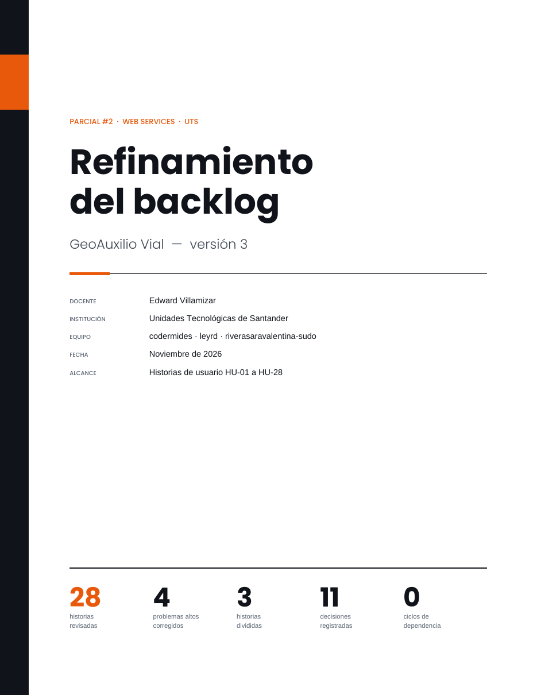

# GeoAuxilioVial
GeoAuxilio Vial brinda asistencia vial inmediata (ponchaduras, batería, grúa) y resuelve la falta de seguimiento preventivo. Cotiza solicitudes, asigna al proveedor más cercano, rastrea rutas en tiempo real y programa mantenimientos. Gestiona usuarios, vehículos, ubicaciones, historial, pagos y calificaciones con geolocalización y pagos seguros.

## Refinamiento del backlog

📄 **[Abrir el PDF del refinamiento del backlog](docs/refinamiento/Refinamiento_Backlog_GeoAuxilioVial_final.pdf)**

- 28 historias de usuario revisadas (HU-01 a HU-28).
- 4 problemas de prioridad alta corregidos (HU-28, HU-12/HU-19, HU-26 y HU-25).
- 3 historias de talla XL divididas en sub-issues (HU-19, HU-20 y HU-26).
- 11 decisiones abiertas registradas con propuesta, responsable e impacto.
- Grafo de dependencias sin ciclos, ordenado en 9 olas de trabajo.

## Historias de usuario

Las 28 historias están en [`docs/historias_usuario`](docs/historias_usuario/README.md).
